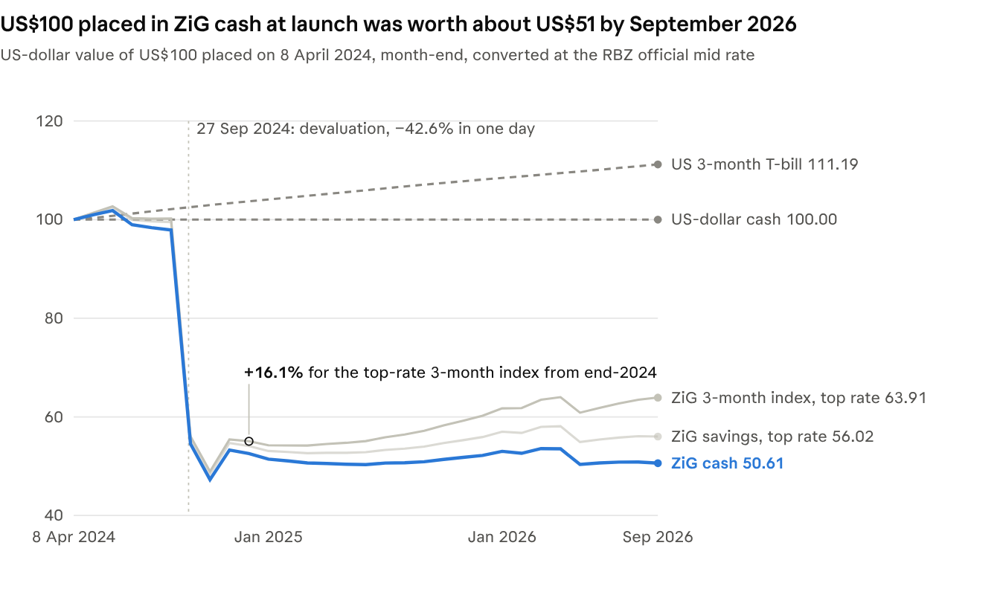

# Does holding Zimbabwe's ZiG pay? Returns in US-dollar terms, April 2024 – September 2026

**Short answer:** not since launch. US$100 placed in ZiG cash on 8 April 2024 was worth about US$51 by September 2026. Since January 2025, though, ZiG term deposits at the top quoted rate have beaten the US Treasury bill; savings accounts have not.



**Explore:** [Full research report](docs/research-report.md) · [Interactive story on Tableau Public](https://public.tableau.com/app/profile/nelson.mwerenga7376/viz/DoesholdingZimbabwesZiGpay/DoesholdingZiGpay) · [Power BI report pages](#power-bi-report) · [Code and SQL](#what-is-in-this-repository) · [Business Requirements Document](docs/BRD.md)

**The question:** if a Zimbabwean treasurer or pension fund keeps money in ZiG, Zimbabwe's gold-backed currency, rather than in US dollars, do they come out ahead once inflation and exchange-rate moves are counted?

**Why it matters:** on 12 November 2026 the central bank (RBZ) said it wants to build a short-term ZiG "yield curve", meaning a set of interest rates for different terms, so that people save in ZiG and not only spend it. Savers will do that only if ZiG earns more than US dollars. This project measures whether it has.

## Three findings
1. **Since launch, no ZiG product available at launch held its US-dollar value.** From 8 Apr 2024 to 30 Sep 2026, ZiG cash lost **49.4%** in US-dollar terms. A return index at the top quoted 3-month deposit rate still lost **36.1%** (36.7% if each 3-month term locks its rate). One day, the 27 Sep 2024 devaluation (−42.6%), drives most of the loss.
2. **Since January 2025, ZiG term deposits at the top quoted rate have beaten the US Treasury bill; savings accounts have not.** The top-rate 3-month index gained **+16.1%** in US-dollar terms over 21 months (+14.8% with locked 3-month terms). In 2026 it beat the Treasury bill by **4.4 points a year** (3.6 with locked terms), while ZiG savings trailed it by **3.6 points**.
3. **Converting US dollars into ZiG for short holds does not clear the hurdle at today's rates.** Someone who already earns ZiG needs about **7.0%** a year (effective) to match the Treasury bill. Someone who converts US dollars in and back out pays a 4.9% round trip, so needs **12.4%** for a one-year hold and **30.6%** for three months. The top 3-month rate, 13.9% quoted (14.6% effective), clears the one-year hurdle but not the shorter ones.

## Built with
- **Data collection and cleaning:** Python (pandas, pdfplumber, openpyxl). 593 RBZ daily rate PDFs, 78 ZIMSTAT CPI reports, IMF and FRED series; every rejected row is logged with its reason.
- **Database:** PostgreSQL 18. Star schema with temporal keys and CHECK constraints; 34 validation queries and 6 negative tests, all passing.
- **Analytics:** Python (numpy). Daily return engine, interest-versus-currency log bridge, break-even yield model, 10,000-path Monte Carlo and rolling-window loss analysis.
- **Business intelligence:** Power BI (TMDL model, DAX measures, 5 report pages) and Tableau (9 sheets, a dashboard and a story).
- **Assurance:** 30 of 30 headline values tie out between the dashboards and the result tables.

## Power BI report

The report has five pages, each titled with its finding:

| Page | What it shows |
| --- | --- |
| Summary | Eight headline KPIs and every finding with its confidence |
| FX and value | The RBZ official rate and the US$ value of 100 placed in each product |
| Versus USD | Annualised gap to the US T-bill by period |
| Break-even | The ZiG yield needed to match the T-bill, against effective rates on offer |
| Risk | How often 90-day holdings lost US-dollar value |

Open `ZiG Returns.pbip` in Power BI Desktop to explore it (see Reproduce, step 6).

## What is in this repository

| Path | What it is |
| --- | --- |
| `ZiG Returns.pbip`, `ZiG Returns.Report/`, `ZiG Returns.SemanticModel/` | Power BI report saved as a Power BI project: the model in TMDL and the report in PBIR, so every measure and visual is readable text. 5 pages: Summary, FX and value, Versus USD, Break-even, Risk |
| `tableau/ZiG Returns.twb` | Tableau workbook: 9 sheets, a dashboard and a 5-point story ([published on Tableau Public](https://public.tableau.com/app/profile/nelson.mwerenga7376/viz/DoesholdingZimbabwesZiGpay/DoesholdingZiGpay)) |
| `data/` | The 9 CSV files both BI tools read |
| `results/` | Analysis result tables (returns, sub-period spreads, scenarios, rolling windows, findings) |
| `clean/` | Cleaned source data: RBZ daily rates, IMF rates, RBZ deposit rates, ZIMSTAT CPI, FRED benchmarks, RBZ events, plus reconciliation files |
| `sql/` | PostgreSQL 18 schema (temporal keys, constraints), load scripts, 34 validation checks and 6 negative tests, analysis extract |
| `scripts/` | Python: fetch the source files, clean them, run the analysis, prepare the BI data, and generate the Power BI and Tableau files |
| `docs/` | The research report (with its charts in `docs/img/`), the research brief, one hand-off pack per pipeline stage, and the BRD |

## Method

```
News trigger ─► 1 Research brief ─► 2 Clean data ─► 3 PostgreSQL 18 ─► 4 Analytics ─► 5 Dashboards and BRD
(RBZ, 12 Nov)   (facts checked     (Python,        (star schema,     (Python:         (Power BI report,
                 at source)         pdfplumber,     40 of 40 checks   returns engine,  Tableau story,
                                    pandas)         pass)             Monte Carlo)     BRD)
```

- Built with a five-stage AI-assisted pipeline (UMFDOP). I reviewed and approved each stage on the evidence it produced: row counts, validation output, result tables and a final tie-out.
- **Tie-out:** the browser dashboard, the Power BI report and the Tableau workbook each show the same 10 headline numbers as the result tables. 30 of 30 values match.
- The return engine was checked against an independent SQL calculation and matches to the last decimal.

## Data (all public)
- [RBZ daily official exchange rates](https://www.rbz.co.zw/index.php/research/markets/exchange-rates): 593 daily rate sheets (PDF)
- [RBZ bank deposit rates, Table 8.2](https://www.rbz.co.zw/index.php/research/markets/interest-rates) (Excel)
- [ZIMSTAT consumer price indices](https://www.zimstat.co.zw/consumer-price-index/): 78 monthly reports
- [IMF exchange-rate data](https://data.imf.org/en/datasets/IMF.STA:ER), used to cross-check
- [FRED, US 3-month Treasury bill](https://fred.stlouisfed.org/series/DTB3), the US-dollar benchmark

## Reproduce

Run from the repository root, which serves as the run folder (`raw/`, `clean/`, `results/`). Python 3.10+ with pandas, pdfplumber, openpyxl, numpy and psycopg 3; PostgreSQL 18.

1. `python scripts/fetch_zig_returns.py .` then `python scripts/fetch_zig_returns_pass2.py .` download the source files into `raw/` (not committed; about 700 PDFs).
2. `python scripts/clean_zig_returns.py .` writes `clean/` and `rejects/`.
3. `createdb umfdop` (UTF8), then `DB=umfdop bash sql/run_db.sh` builds the schema, loads `clean/` and runs the validation and negative tests.
4. `UMFDOP_DSN="dbname=umfdop" python scripts/agent4_zig_returns.py .` then `python scripts/agent4_findings.py .` write `results/`.
5. Export the daily rate view in psql: `\copy (SELECT date_key, units_per_usd AS zwg_per_usd, is_carried_forward, rate_source FROM mart.v_fx_daily WHERE currency_code = 'ZWG' AND rate_type = 'RBZ official' ORDER BY date_key) TO 'fx_daily.csv' CSV HEADER`. Then `python scripts/prepare_bi_data.py results fx_daily.csv data` writes the BI data files.
6. Open `ZiG Returns.pbip` in Power BI Desktop. In Transform data, set the `DataFolder` parameter to your local `data\` folder (with a trailing backslash), then Refresh. Open `tableau/ZiG Returns.twb` in Tableau and point the connections to the same folder if prompted.

## Limits and next steps
- Deposit rates are the lowest and highest rates banks quoted, not averages weighted by volume.
- Taxes, fees, the transfer tax and street exchange rates are not included.
- The 3-month deposit figures are a return index at the published rates (rate re-read monthly, monthly compounding), not observed investor returns. `results/result_sensitivity.csv` repeats them with locked 3-month terms.
- Simulation results are conditional on a model fitted to 21 calm months; the 90-day loss windows overlap and are not independent.
- The RBZ's new 90-day ZiG bill has been running for only four months.
- Next steps: add the RBZ's later bill auction results and bank-level deposit rates, and refresh monthly.

**Revision, 14 Nov 2026:** after a review of the published work, the break-even formula was corrected (hurdles rose by 0.07 to 0.09 points), the stress test is now stated as a shortfall in ending wealth, and several labels were qualified. Details are in the [report's revision note](docs/research-report.md#revision-note-14-november-2026).

All figures are analysis, not investment advice.
