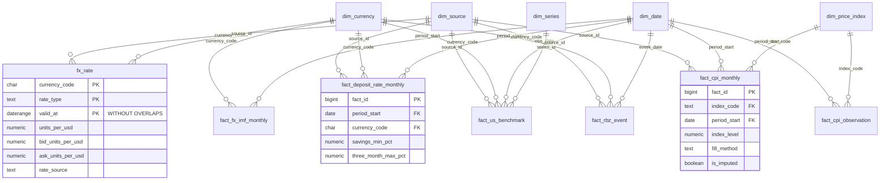

# Agent 3 - Database Build Pack
Inputs: Agent 2 pack 2026-11-13 (`umfdop/packs/agent2-pack-2026-11-13-zig-returns.md`), approved by Nelson. Run log rows out: FX 647, IMF 60, deposit rates 69, CPI monthly 93, CPI observations 214, US benchmarks 1,339, events 12.
Mode: autonomous. Built, loaded and validated in Claude's workspace on PostgreSQL 18.7.
Files: `umfdop/sql/` holds 01_ddl.sql, 02_load_*.sql (7), 03_validate.sql, 04_negative_tests.sql and run_db.sh. A database dump is in the Step 3 zip.

## 1. Model summary
| Table | Type | Grain | Natural key |
|---|---|---|---|
| core.dim_date | dim | One calendar day, 2015-2030 | date_key |
| core.dim_currency | dim | One currency (USD, ZWG, ZWL) | currency_code |
| core.dim_source | dim | One source dataset (D1-D7) | source_id |
| core.dim_price_index | dim | One CPI series (ZWG, USD, Weighted) | index_code |
| core.dim_series | dim | One US benchmark series (DTB3, SOFR, CPIAUCSL) | series_id |
| core.fx_rate | temporal reference | One published ZiG/USD rate, valid until the next published rate | (currency_code, rate_type, valid_at WITHOUT OVERLAPS) |
| core.fact_fx_imf_monthly | fact | One IMF rate per month per transformation | (period_start, transformation) |
| core.fact_deposit_rate_monthly | fact | One month of quoted bank deposit rates in one currency | (period_start, currency_code) |
| core.fact_cpi_monthly | fact | One CPI level per index per month | (index_code, period_start) |
| core.fact_cpi_observation | fact | One CPI level as stated in one ZIMSTAT release | (index_code, period_start, published_in, role) |
| core.fact_us_benchmark | fact | One observation per US series per date | (series_id, obs_date) |
| core.fact_rbz_event | fact | One RBZ instrument or policy event | (event_date, event_type, instrument, tenor_days, currency_code), NULLS NOT DISTINCT |
| audit.load_log | audit | One load run per table | load_id |

Mart views (read-only role `bi_reader`):
- `v_fx_daily`: one rate per calendar day; weekends and holidays carry the last published rate with an `is_carried_forward` flag.
- `v_fx_monthly`: monthly average and month-end rate, alongside the IMF comparators.
- `v_cpi_monthly`
- `v_deposit_rates_monthly`
- `v_us_benchmarks_monthly`
- `v_rbz_events`
- `v_monthly_inputs`: one row per month with every input for BQ1 and BQ2.

No returns are calculated in the database; that is Agent 4's work.

Design choices:
- The exchange rate is the only temporal table, because a published rate holds until the next one. `valid_at` = [rate date, next rate date), so the 33 no-rate weekdays and all weekends are covered by the last published rate. FCB-sourced rows carry the mid only; a CHECK enforces that their bid and ask are null.
- CHECK constraints encode the Agent 2 rules: ZWG deposit rows only from April 2024; the min/max flags must match the values; `is_imputed` if and only if `fill_method` = chained; bid < mid < ask.
- No `ON DELETE CASCADE`. All facts have `is_deleted`. Every foreign key and filter column is indexed.
- The weighted CPI has no single currency (it blends ZWG and USD prices), so its `currency_code` is NULL in `dim_price_index`.

## 2. ER diagram

## 3-4. DDL and load scripts
See `umfdop/sql/01_ddl.sql` and `02_load_<table>.sql`. Each load truncates staging, then promotes the rows and writes the audit row in one transaction; a failure leaves nothing half-loaded. Run everything with `DB=umfdop bash sql/run_db.sh` from the run folder (the folder holding `clean/` and `sql/`).

## 5-6. Validation and test results (tested in sandbox, PostgreSQL 18.7)
- **34 of 34 validation checks pass**: row counts per table, totals by currency, date coverage, tie-outs, business rules and read-only access.
- **6 of 6 negative tests pass**: overlapping rate period (23P01), duplicate CPI month (23505), unknown currency (23503), bid above mid, a ZWG row before April 2024, and an inconsistent imputation flag (all 23514).

Two issues came up during testing and were fixed. None was waved through:
1. **V10 failed on the first run.** The RBZ month-end rate for Feb 2026 is 25.7733, which matches the RBZ PDF of 2026-02-27. The IMF figure is 25.7730, a 0.0012% difference. This also corrects the Agent 2 pack, which said the month-end values were identical in every month; they match in 26 of 27 months. The check now uses a 0.01% tolerance, because extraction errors (dropped digits) move a rate by 10% or more. A new check, V10b, pins the known exception, so any new mismatched month fails.
2. **N3 hit the wrong constraint.** The test row tripped the April-2024 CHECK before the foreign key. The test was moved to `fact_us_benchmark`. No constraint was changed.

Key values:
- 950 calendar days from 2024-04-08 to 2026-11-13, one row each.
- 33 weekdays carried forward; 54 days sourced from FCB.
- Tie-outs 13.5616, 24.3902, 25.9807 and 26.5861.
- CPI: 93 rows, of which 4 are imputed.
- 30 ZWG deposit-rate months, of which 3 have a min > max flag.
- `bi_reader` can read `mart` and cannot read `core`.

## 7. What to run locally (optional)
0. Create the database as UTF8: `CREATE DATABASE umfdop ENCODING 'UTF8' TEMPLATE template0;` (The sandbox database was rebuilt as UTF8 at Step 4 and re-validated, still 40 of 40 PASS. Use the dump in the Step 4 zip.)
1. Restore the dump: `pg_restore -d umfdop umfdop_zig_2026-11-13.dump`
2. Or rebuild: `DB=umfdop bash sql/run_db.sh`. This needs `clean/` from the Step 2 zip and PostgreSQL 18.
3. Power BI and Tableau connect as a login role granted `bi_reader`, and read the `mart` views only.

Pipeline: Step 3 of 5 - Agent 3 - Waiting for: Nelson's approval
