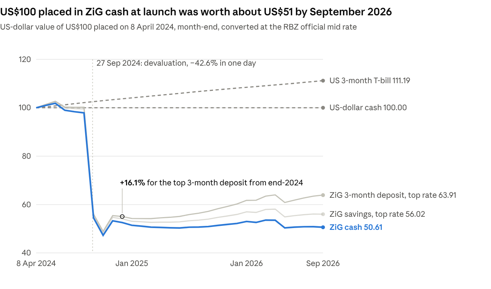
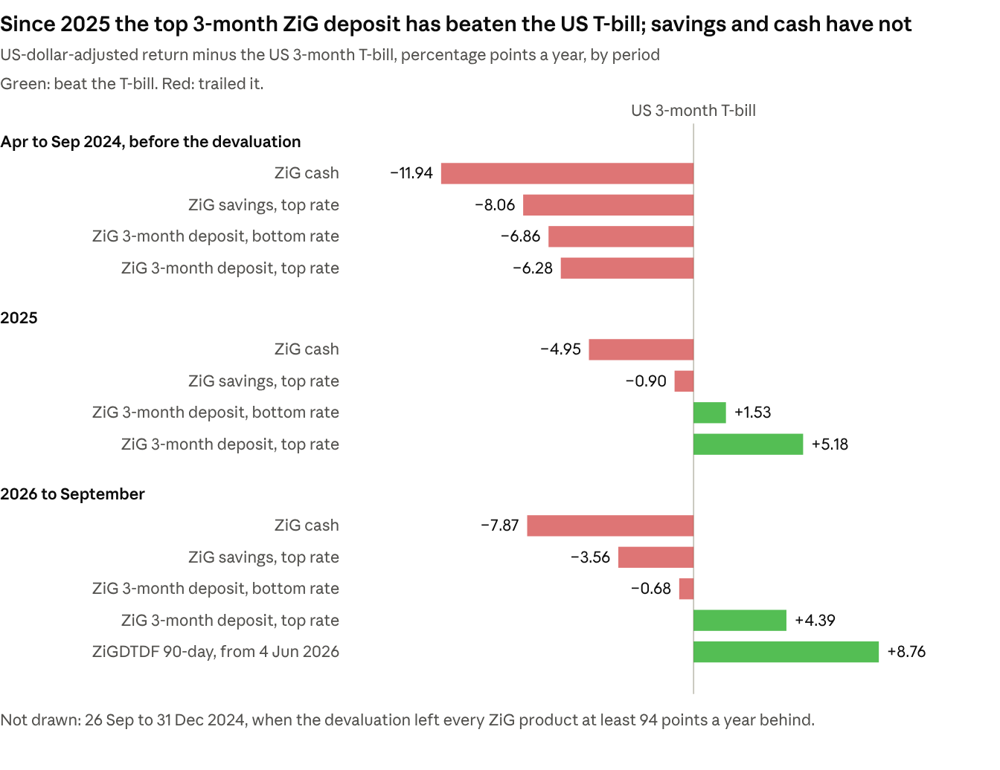
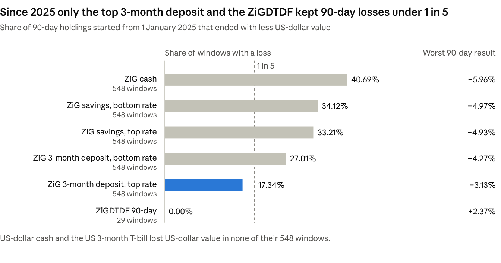

# Does holding ZiG pay? Returns on Zimbabwe's ZiG in US-dollar terms, April 2024 – September 2026

As of 13 November 2026 · Nelson Mwerenga

## Summary

Measured in US dollars from its launch on 8 April 2024 to 30 September 2026, holding ZiG did not pay: ZiG cash lost 49.39% of its value and the best-paying 3-month deposit lost 36.09%. Since January 2025 the picture has reversed for term deposits at the top quoted rates, which beat the US 3-month Treasury bill. Savings accounts and idle cash still lose.

1. **Since launch, the devaluation decides the result.** The 27 September 2024 devaluation took the official rate from 13.9987 to 24.3902 ZiG per US dollar (−42.6%). Across the window the currency effect is −68.10 log points; interest earned offsets at most 23. In real terms, using ZIMSTAT's ZiG CPI, cash lost 49.56%. US-dollar cash held in Zimbabwe also lost 15.26% in real terms (ZIMSTAT US-dollar CPI).
2. **Since 2025, 3-month deposits beat the T-bill.** A 3-month deposit at the top quoted rate earned +16.08% in US-dollar terms over 21 months. That is 8.90% a year against 4.06% for the T-bill. The spread was +5.18 percentage points a year in 2025 and +4.39 in 2026 to September. The RBZ's 90-day ZiG deposit-taking facility (ZiGDTDF) beat the T-bill by 8.76 points a year over its first 118 days. The top savings rate trailed by 3.56 points.
3. **Conversion cost, not the yield, decides short holds.** Someone who already holds ZiG needs 6.88% a year to match the T-bill if the 2026 depreciation pace continues. A US-dollar holder who converts needs 12.36% for a 12-month hold and 30.54% for a 3-month hold, because the RBZ bid–ask round trip costs 4.88%. In a calm-market Monte Carlo, an 11% ZiGDTDF holding beats the T-bill over 12 months with 77.9% probability. A repeat of the September 2024 devaluation inside that year would leave it 40.45% behind.
4. **Losses since 2025 are smaller and rarer.** ZiG cash lost US-dollar value in 40.69% of 90-day windows since January 2025; the top 3-month deposit did so in 17.34%; the ZiGDTDF in none of its 29 windows. The worst 90-day loss for cash since 2025 was −5.96%, against −52.01% over the full window.
5. **The bottom line for a treasurer.** ZiG term deposits now pay a real premium over US dollars, but only for money already in ZiG or held for a year or more, and only while the exchange rate stays stable. The premium is small next to a one-off devaluation.

## Background and research questions

The Reserve Bank of Zimbabwe (RBZ) wants ZiG balances held, not just spent, and holders will only do that if ZiG pays more than US dollars after depreciation, inflation and conversion costs. The ZiG (ISO code ZWG) launched on 8 April 2024 at 13.5616 per US dollar. On 27 September 2024 the official rate moved from 13.9987 to 24.3902 in one day. Since then the rate has been close to stable: the ZiG lost 3.04% against the dollar in 2026 to 30 September.

On 12 November 2026 the RBZ Governor said he wants the ZiG to become a store of value and plans a short-term ZiG yield curve ([Bloomberg](https://www.bloomberg.com/news/articles/2026-11-13/-usd-zwg-zimbabwe-moves-to-rebuild-local-bond-market-after-currency-turmoil)). The first instrument on that curve is the ZiG deposit-taking facility (ZiGDTDF). Its first 90-day auction on 4 June 2026 cleared at 10.98% ([Herald](https://www.heraldonline.co.zw/rbz-moves-to-anchor-zig-as-store-of-value/)). The Bank Policy Rate has been 27.5% since 28 September 2026 ([Herald](https://www.heraldonline.co.zw/rbz-cuts-policy-rate-to-275pc/)).

The results matter to corporate treasurers, pension funds and insurers that hold prescribed assets, to banks pricing ZiG deposits and bidding at ZiGDTDF auctions, and to Treasury as it rebuilds a domestic debt market. The research set four questions, each with a hypothesis stated before any data was loaded.

| ID | Question | Hypothesis | Result |
| --- | --- | --- | --- |
| BQ1 | What nominal, real and US-dollar-adjusted return did ZiG cash, savings, 3-month deposits and ZiGDTDF paper earn, month by month, since April 2024? | Every ZiG product is worse than −30% since launch, but 3-month deposits are positive from January 2025 | Held: cash −49.39%, best 3-month deposit −36.09%; 3-month deposit +16.08% since January 2025 |
| BQ2 | By sub-period, what spread did ZiG products earn over the US 3-month T-bill? | In 2026 the top 3-month deposit and the ZiGDTDF beat the T-bill by 3 points or more; savings do not | Held: +4.39 and +8.76 points a year; savings −3.56 |
| BQ3 | What ZiG yield beats US dollars for a given depreciation, holding period and conversion cost? | About 6.7% for existing ZiG holders; about 12% for a 12-month and 30% for a 3-month conversion | Held: 6.88%, 12.36% and 30.54% |
| BQ4 | How often does a 30- or 90-day ZiG holding end with a US-dollar loss, and how large is the tail? | Losses cluster in September–October 2024; since 2025, under 20% of 90-day windows lose | Partly held: true for the top 3-month deposit (17.34%), not for cash (40.69%) or savings (about 33%) |

## Data

Every figure comes from free public data, most of it published by the RBZ, ZIMSTAT and the US Federal Reserve. All of it was downloaded by script, cleaned and loaded into a PostgreSQL 18 database.

| Dataset | Publisher | Coverage | Used for |
| --- | --- | --- | --- |
| Daily official interbank rate (bid, ask, mid) | RBZ, one PDF per day | 593 PDFs for 680 business days, 2024-04-08 to 2026-11-13 | Currency effect, conversion cost |
| Gap-day rates | First Capital Bank, republishing the RBZ rate | 54 business days with no RBZ file | Filling RBZ gaps |
| Monthly exchange rate | IMF (ER dataset) | Monthly to June 2026 | Cross-check of the daily series |
| Commercial-bank ZiG deposit rates (Table 8.2) | RBZ | Monthly, April 2024 to September 2026; savings and 3-month, minimum and maximum quoted | Interest earned |
| Consumer price indices (ZiG, US dollar and weighted) | ZIMSTAT, one PDF per month | 78 PDFs; April 2024 to October 2026 | Real returns |
| US 3-month T-bill (DTB3), SOFR and US CPI | Federal Reserve Bank of St. Louis (FRED) | Daily or monthly, from April 2024 | US-dollar benchmark |
| Policy and auction events | RBZ via the Herald, NewsDay and the IMF | 12 events, including the devaluation and ZiGDTDF auctions | Event markers, ZiGDTDF yield |

The exchange-rate series has 647 business days with a published rate. 33 business days have no rate from either source; 25 of them are public holidays. On those days, and at weekends, the last published rate holds. Four of the 93 CPI index months had no release of their own and were chained from published month-on-month changes; they are flagged.

Checks run before any analysis:

- First Capital Bank matched the RBZ rate exactly on all 7 days both published.
- RBZ month-end rates matched the IMF series in 26 of 27 months. The exception differed by 0.0012%.
- 16 of 16 figures quoted in the research brief tied to the cleaned data.
- 40 of 40 database checks passed: 34 validation queries and 6 tests that try to load bad rows.

## Method

Each product is valued daily, as if a fixed sum were deposited and left alone, then converted to US dollars at the RBZ official mid rate for that day. No forecasting model was fitted: the questions are descriptive and what-if, so the simplest exact method was used and checked by identities.

**Products compared.** ZiG cash (no interest); ZiG savings and 3-month deposits, each at the minimum and the maximum rate banks quote in RBZ Table 8.2; and the 90-day ZiGDTDF, held at its first auction rate of 10.98% from 4 June 2026. The benchmarks are US-dollar cash (no interest) and the US 3-month T-bill, converted from FRED's discount basis to a bond-equivalent yield.

**US-dollar-adjusted return.** Interest accrues daily at the quoted annual rate and compounds monthly. The ZiG return is then adjusted for the change in the exchange rate S (ZiG per US dollar):

```math
R_{USD} = (1 + R_{ZWG}) \times \frac{S_{start}}{S_{end}} - 1
```

Taking logarithms splits each result exactly into an interest effect and a currency effect, which add up to the total. Real returns deflate ZiG returns by ZIMSTAT's ZiG CPI and US-dollar returns by ZIMSTAT's US-dollar CPI.

**Sub-periods.** Pre-devaluation (8 April to 26 September 2024); the devaluation and its aftermath (26 September to 31 December 2024); calendar 2025; 2026 to 30 September; and since 2025 as a whole. Returns are annualised and compared with the T-bill as a spread in percentage points a year.

**Required yield.** The ZiG yield y that matches the T-bill, for a US-dollar rate r, an expected annual depreciation e, a holding period of T years and a round-trip conversion cost c:

```math
y = \frac{(1 + r)(1 + e)}{(1 - c)^{1/T}} - 1
```

Current values: r = 4.15% (October 2026), e = 2.62% a year (the 2026 pace to 13 November) and c = 4.88% (1 − bid/ask on the RBZ rate of 13 November). For someone who already holds ZiG, c = 0.

**Monte Carlo and stress test.** Monthly exchange-rate changes were drawn from a normal distribution fitted to the 21 calm months from January 2025 to September 2026 (mean −0.18% a month, standard deviation 1.60%). 10,000 twelve-month paths were run with a fixed seed of 42. The stress test applies one repeat of the September 2024 move (−42.6%) inside the hold.

**Loss windows.** Every 30-day and 90-day holding period starting on each calendar day was valued, giving 816 to 876 windows per product (29 to 89 for the ZiGDTDF). A window loses if it ends with less US-dollar value than it started with. Maximum drawdown is the largest fall from a previous peak.

## Finding 1: Since launch, the devaluation decides the result



*Source: [results/result_returns_monthly.csv](../results/result_returns_monthly.csv) · month-end values, 8 April 2024 to 30 September 2026*

Every ZiG product lost US-dollar value between 8 April 2024 and 30 September 2026, and the September 2024 devaluation accounts for almost all of it. The currency effect was −68.10 log points for every product. Interest offset 23.33 log points at the top 3-month rate, 10.16 at the top savings rate and nothing for cash. At the bottom quoted rates, 3-month deposits lost 40.85% and savings 44.28%.

After the devaluation the lines part. From January 2025 the bottom-rate 3-month deposit gained 8.25% in US-dollar terms, while ZiG cash lost a further 3.73%. In real terms ZiG cash lost 49.56% of its purchasing power from May 2024, and US-dollar cash held in Zimbabwe lost 15.26%. The T-bill lost 6.1% in real terms, so holding US dollars was not free either.

## Finding 2: Since 2025, 3-month deposits beat the T-bill; savings do not



*Source: [results/result_subperiods.csv](../results/result_subperiods.csv) · annualised, 8 April 2024 to 30 September 2026*

After depreciation, the top quoted 3-month rate returned 9.43% a year in US-dollar terms in 2025 and 8.21% in 2026, against 4.24% and 3.82% for the T-bill. The bottom quoted 3-month rate roughly matched the T-bill. The ZiGDTDF's lead rests on 118 days at its first-auction rate, a window in which the ZiG firmed slightly.

Even before the devaluation every ZiG product trailed the T-bill, because the ZiG drifted weaker from launch. US-dollar cash, which earns nothing, trailed the T-bill by about 4 points a year in every period. The ZiG lost 3.04% against the US dollar in 2026 to 30 September, matching Bloomberg's “almost 3%”; to 12 November the loss was 2.1%.

## Finding 3: Conversion cost, not the yield, decides short holds

At the 2026 depreciation pace, a ZiG yield of 6.88% a year matches the T-bill for money already in ZiG. Money converted from US dollars needs much more, because the RBZ bid–ask round trip costs 4.88% and a short hold spreads that cost over few months. Rates on offer in September 2026: the top 3-month deposit paid 13.88%, the ZiGDTDF 10.98% and the top savings rate 4.71%.

| Holder | Required ZiG yield (% a year) | Top 3-month deposit, 13.88% | ZiGDTDF, 10.98% | Top savings rate, 4.71% |
| --- | --- | --- | --- | --- |
| Already holds ZiG, any period | 6.88 | Clears | Clears | Falls short |
| Converts US dollars for 12 months | 12.36 | Clears | Falls short | Falls short |
| Converts US dollars for 6 months | 18.12 | Falls short | Falls short | Falls short |
| Converts US dollars for 3 months | 30.54 | Falls short | Falls short | Falls short |

If banks charged half the RBZ spread (a 2.44% round trip), the hurdles would fall to 9.55% for 12 months, 12.29% for 6 months and 17.97% for 3 months. Faster depreciation raises every hurdle: at 10% a year, an existing ZiG holder needs 14.56%.

**How likely is the premium to be earned?** In 10,000 simulated calm-market years, the ZiGDTDF at 10.98% beat the T-bill over 12 months in 77.9% of paths for an existing ZiG holder, with a median excess return of +4.56%. With the conversion round trip, that fell to 43.1% and a median of −0.92%. The top 3-month deposit, rolled for 12 months, beat the T-bill in 88.8% of paths without conversion and 61.8% with it. The top savings rate beat it in 37.7% of paths even without conversion.

**What a devaluation does.** The simulation is fitted to 21 calm months and has no jumps. A repeat of the 27 September 2024 move inside a 12-month hold leaves the ZiGDTDF 40.45% behind the T-bill and the top 3-month deposit 38.79% behind. Earning that back would take about 6 years at the ZiGDTDF's 2026 premium (8.76 points a year) and about 11 years at the 3-month deposit's (4.39 points). The yield premium is, in effect, payment for carrying that jump risk.

*Source: [results/result_scenarios.csv](../results/result_scenarios.csv)*

## Finding 4: Losses since 2025 are smaller and rarer



*Source: [results/result_rolling.csv](../results/result_rolling.csv) · 90-day windows starting 1 January 2025 or later, ending by 30 September 2026*

Every worst 90-day loss since 2025 comes from the window starting on 10 April 2026; ZiG cash lost about 5.9% in May 2026 alone. Over the full window, which includes the devaluation, the worst 90-day result for ZiG cash was −52.01% and its largest fall from a peak was −53.92%.

Shorter holds tell the same story. Since 2025, ZiG cash lost US-dollar value in 43.26% of 30-day windows and the top 3-month deposit in 16.78%. The ZiGDTDF's clean record covers only 29 windows in a calm stretch, so it says little about how the instrument would fare in a sharp move.

## Implications

The new yield curve can keep money that is already in ZiG, but it cannot yet pull in US dollars for short tenors. The obstacles are the conversion cost and the memory of the 2024 devaluation, not the level of ZiG rates.

- **Corporate treasurers.** ZiG balances that must be held anyway earn more in term deposits at the top quoted rates or in the ZiGDTDF than in savings accounts or cash. Converting US dollars into ZiG pays only for holds of about a year or more at current spreads. Any ZiG position should be sized against a loss of about 40% in a repeat devaluation.
- **Pension funds and insurers.** For long holds of prescribed assets the current rates clear the hurdle. The case rests on exchange-rate stability, so a devaluation stress test belongs in each investment committee pack.
- **Banks.** Quoted savings rates (4.35–4.71% in September 2026) trailed the T-bill in 2025 and 2026 and sit below the 5% ZiG savings minimum reported for the 2026 Monetary Policy Statement. Savers are the group the RBZ most wants to keep, and they are paid least.
- **The RBZ.** Narrowing the interbank spread lowers the hurdle more than a higher auction rate does. At half today's round-trip cost, a 12-month conversion needs 9.55%, below the ZiGDTDF's 10.98%. Publishing ZiGDTDF results after the June 2026 auction would also let holders price the curve; none were found for this study.
- **Treasury.** A domestic debt market needs holders who expect the rate to stay stable. Each year without a devaluation shortens the record that holders price in, and the 2025–26 data show the premium is already there for term money.

## Limitations

Most limitations make ZiG look better than a typical holder experienced, so the losses here are a floor and the gains a ceiling.

| What the study leaves out or assumes | Effect on the results |
| --- | --- |
| Official RBZ mid rate only; the parallel-market premium (about 16–21% in 2026) is not modelled | ZiG looks better for anyone who converts at street rates |
| Top and bottom quoted bank rates, not volume-weighted averages | “Max” results overstate what most depositors earned; “min” results bracket them |
| No taxes, bank fees, withholding tax or the 2% IMTT on foreign-currency transactions | Net returns are lower than shown |
| Conversion cost uses the RBZ interbank bid–ask; retail spreads are usually wider | Required yields for converters are understated |
| 3-month deposits accrue monthly at each month's quoted rate, with no lock-in | Small effect either way |
| ZiGDTDF held at its 10.98% first-auction rate; only 118 days of history; no later auction results found | Low confidence in ZiGDTDF figures |
| Monte Carlo fitted to 21 calm months with normally distributed moves and no jumps | Probabilities of beating the T-bill are optimistic; the stress test covers the jump |
| Bank deposit rates end in September 2026, so returns stop at 30 September even though exchange rates run to 13 November | October–November 2026 not covered |
| 4 of 93 CPI months chained from month-on-month changes; April 2024 is the CPI base month, so real returns start in May 2024 | Small effect on real returns |
| 8 working days with no published rate; the last rate is carried forward | No material effect |

## Validation and deliverables

Every headline number was reproduced two ways and ties out in all three dashboards: 30 of 30 values match.

- The daily Python engine and an independent SQL query both give −49.390405% for ZiG cash since launch.
- The interest and currency effects add exactly to the total for every product (check rows = 0).
- Monthly returns compound to the cumulative index within 5 × 10⁻¹⁴.
- All first-order figures in the research brief tie to the final results, including −48.9% for cash to 12 November and −2.1% for 2026 to 12 November.
- Ten headline values were checked in the browser dashboard, the Power BI report and the Tableau story. All 30 matched the result tables.

| Deliverable | What it holds | Where |
| --- | --- | --- |
| This report | Questions, data, method, findings, implications and limits | `docs/research-report.md` |
| Business Requirements Document | Twelve requirements and eight acceptance criteria, all met | [docs/BRD.md](BRD.md) |
| Power BI report | Five-page report, saved as a text-based project (PBIP) | [`ZiG Returns.pbip`](../ZiG%20Returns.pbip) |
| Tableau workbook | Nine sheets, a dashboard and the story “Does holding ZiG pay” | [`tableau/ZiG Returns.twb`](../tableau/ZiG%20Returns.twb) |
| Code and SQL | Download, cleaning and analysis scripts; PostgreSQL schema, loads and checks | [scripts/](../scripts) and [sql/](../sql) |
| Result tables | Every number in this report | [results/](../results) |
| Pipeline packs | The research brief and one hand-off pack per stage | [docs/](.) |

## Sources

Primary data

- RBZ daily interbank rates: [8 April 2024 (launch)](https://www.rbz.co.zw/documents/Exchange_Rates/2024/April/RATES_8_APRIL_2024.pdf), [27 September 2024 (devaluation)](https://www.rbz.co.zw/documents/Exchange_Rates/2024/September/RATES_27_SEPTEMBER_2024.pdf), [13 November 2026](https://www.rbz.co.zw/documents/Exchange_Rates/2026/November/RATES_13_NOVEMBER_2026.pdf); 593 daily files in all
- [RBZ Table 8.2, average commercial-bank deposit rates](https://www.rbz.co.zw/documents/statistics/2026/August/Bank-Deposits-rates.xlsx)
- [ZIMSTAT ZiG CPI, October 2026](https://www.zimstat.co.zw/wp-content/uploads/Macro/Prices/CPI/2026/CPI_ZWG_10_2026.pdf); the US-dollar and weighted CPI files follow the same pattern
- [FRED DTB3, US 3-month T-bill](https://fred.stlouisfed.org/graph/fredgraph.csv?id=DTB3) and [FRED CPIAUCSL, US CPI](https://fred.stlouisfed.org/graph/fredgraph.csv?id=CPIAUCSL)
- [IMF exchange-rate series for Zimbabwe (ER)](https://api.imf.org/external/sdmx/2.1/data/IMF.STA,ER/ZWE.USD_XDC.PA_RT.M?startPeriod=2024-01)
- [IMF staff report on Zimbabwe, July 2026](https://www.imf.org/-/media/files/publications/cr/2026/english/1zweea2026002.pdf)
- [First Capital Bank exchange rates, 31 December 2025](https://www.firstcapitalbank.co.zw/wp-content/uploads/2025/12/Exchange-Rates-31-December-2025.pdf), used for RBZ gap days

News and policy

- [Bloomberg: Zimbabwe moves to rebuild local bond market after currency turmoil](https://www.bloomberg.com/news/articles/2026-11-13/-usd-zwg-zimbabwe-moves-to-rebuild-local-bond-market-after-currency-turmoil), 13 November 2026
- [Herald: RBZ moves to anchor ZiG as store of value](https://www.heraldonline.co.zw/rbz-moves-to-anchor-zig-as-store-of-value/) (first ZiGDTDF auction)
- [NewsDay: RBZ mops up liquidity with new ZiG bills](https://www.newsday.co.zw/local-news/article/200056702/rbz-mops-up-liquidity-with-new-zig-bills) (ZiGDTDF tap rates)
- [Herald: RBZ cuts policy rate to 27.5%](https://www.heraldonline.co.zw/rbz-cuts-policy-rate-to-275pc/)
- [Herald: 2026 monetary policy milestones](https://www.heraldonline.co.zw/single-digit-inflation-stable-exchange-rate-mark-2026-monetary-policy-milestones/) (minimum deposit rates)

Results: every chart and figure in this report is read from the result tables in the [results/](../results) folder of this repository.
